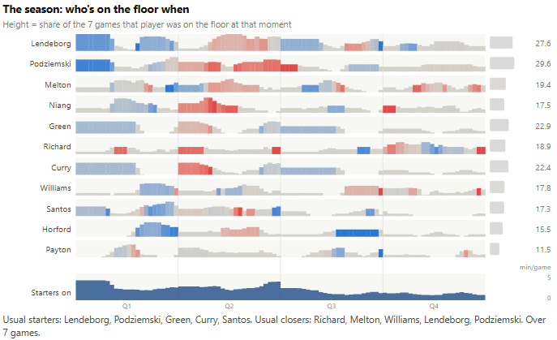

# Visualization Examples

This page showcases data visualization projects completed as part of CMSI-670. Each example includes a screenshot, a link to the interactive visualization, an explanation of how to use it, and a discussion of the design choices behind it.

---

## Visualization 1

**Website:** [View Interactive Visualization](https://www.hoopstreak.com/stats/passing)

### Overview
This is an adjacency matrix visualization that showcases how players on a certain team pass to one another. The horizontals represent the passer and the vertical encodes the player receiving the ball. The players are sorted by who makes the most passes so the marginal frequencies on the right will be sorted from largest to smallest while the ones on the bottom may not be in order, highlighting players that may pass the ball more, and those that may receive the ball more.

### How to Use
The main page displays all 30 teams in a small multiple view with a default of 8 players displayed per team. However, this slider can be moved to dynamically update the view for all teams. Auto-generated text is displayed below each grid highlighting the top connection and how much % of a team's passes the top passer makes. Hovering over squares or player images in the graph changes the text displayed. A players face reveals how many passes a player makes and receives and to whom and from whom they pass and receive the most from. Hovering a square in the matrix displays how many passes that horizontal player makes to the vertical player. It also displays how many assists that combo has and the shooting percentage that player has after the pass. You can use one of the dropdown menus to change seasons and the other to select an individual team to analyze even further. In basic mode, the color gradient represents the number of passes made relative to the league with the lower colors being fewer. In advanced mode (toggled by selecting the checkbox), the color now represents the points per shot after the pass relative to the league with blue being below average and red being above average. The size now represents the number of passes relative to the league. In advanced mode, the hover now changes the text to also display the average points per shot of each square.

### Design Choices
I chose to design this chart type because I have not seen it done before for basketball and I thought it was a super unique way to visualize how players interact with each other on the court. It is super important to understand which players pass the most amongst each other to understand how a team's offense operates. It is also important to see the tendencies of the receiving player after the pass. Do they shoot? If they do shoot, do they shoot well? I used the color gradient from blue to red to represent the real world model of cold and hot. At first, I thought of using green and red because those are universally known to represent good and bad. However, this decreases usability and generalizability for users who may be colorblind and mix those colors up. The small multiple helps highlight how different teams run their offense differently. One player might make a majority of the passes or receive a majority of the passes on one team while other teams may have a much more even spread. The average points per shot coloring also allows you to immediately find the player combinations that are the most effective at on certain teams. The marginal distributions allow uses to immediately understand the total passes players make and how that differs from their teammates. The slider allows you to keep the same dimensions of the data, but either focus on the whole team or only the most active players. The basic vs. advanced mode was something I valued a lot because I feel like a big aspect of design is making the users feel like they are in control and allowing for users of different backgrounds to understand the data. A novice at basketball data may be overwhelmed by the advanced mode and may extract better meaning through the basic mode while a high-level analyst may prefer the advanced mode for the extra metrics it displays. The design may take a few minutes to get used to, but once you understand it, the concept is consistent and easy to visualize.

---

## Visualization 2

**Website:** [View Interactive Visualization](https://www.hoopstreak.com/stats/rotations)

### Overview
This is a unique graph that shows when basketball players are usually on the floor and when they are not highlighting a team's rotations. The height of each bar is the share of the total number of games that player was on the floor at that moment over the entire 4 quarters of the basketball game. The marginal frequencies on the left encode the player's average minutes per game with the actual number displayed on the right. The bottom histogram represents the number of starters on the floor at that given time. It even includes auto-generated text at the bottom displaying the usual starters and usual closers of the games.

### How to Use
The main graph shows a histogram for each player and on average, throughout all their games, when they are on the floor. The bottom histogram showcases the average number of starters on the floor at any given time. Below this graph is another graph that has horizontal bars showing when in a certain game a player was on the court. This is auto-selected from the first game of the season, but the small multiples below this graph showcase the same graph for each game of the season. All of these graphs are connected as hovering a player's row in one graph highlights that player's row for every graph allowing for direct comparison. The second main graph on the page is colored in basic mode. In basic mode, the color represents whether the team was outscored or if they outscored the other team with blue encoding them being outscored and red encoding them outscoring the other team. In advanced mode, this bottom graph keeps the same color coding but changes the height of each individual bar to represent how many points that player scored during that time on the floor with larger heights representing more points. This allows for users to analyze when players were scoring the most, and if their scoring led to their team outscoring the other team during that time period. This graph also has auto-generated text at the bottom stating the best stint from a player on the team and the worst stint from a player on the team. The best and worst stint are determined from the +/- of the players (the scoring differential while they were in the game). Highlighting a row changes the text to state the player's name, the minutes, the number of stints they had, and the number of points they scored. The advanced mode also changes the colors of the main graph with the same outscoring blue and red color scheme to show which players are usually outscoring the other team and when that is happening. Hovering over a player's name in this graph updates the text at the bottom stating the players average minutes, how many games they played of the team's total games, how many games they started, and how many games they closed.

### Design Choices
TODO: Explain the reasoning behind the visualization's design. Consider:
- Why this particular chart type was chosen.
- Why specific colors were used.
- How the layout helps communicate the data.
- How the design makes the visualization easier to understand.

I chose to design this graph because while I have seen a team's rotations during a game represented like this, I felt like more data could be displayed. That is why I chose to include the size being affected in advanced mode and using that to encode points scored during that stint. I have also never seen an aggregated view like the first graph that showcases on average when a player is on the court and when they are on the court, if they are outscoring or getting outscored by the other team. The auto-generated text also provides relevant information via a different modality and compliments the visual well. As stated previously, I used these colors to make the graph more usable. I also used the same color-coding to remain consistent. The layout is awesome because it uses small multiples and main graphics to display the data. The first main visual shows seasonal trends and the second one shows how impactful players were when they were on the floor during a specific game. Like the other visual, I included a basic and advanced mode to allow for users of different backgrounds to enjoy the graphs equally. The advanced mode can get overwhelming which is why the basic mode does not encode as much information. The design makes the visualization easier to understand because it is consistent and provides relevant context. The text provides extra information and the colors highlight areas of focus from the muted grays.

---
